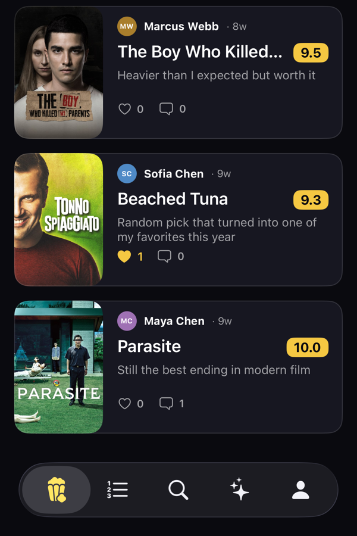
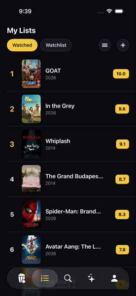

# Popcorn

A social app for movie taste: rank films by picking between two at a time, build a personal ranked list, and see what your friends are watching. Think Beli, but for film.

> **Status:** in development, not launched. It runs on the iOS Simulator and on a physical device; there is no App Store build, and the social features run against a small seeded backend.

<p>
  
  
  
</p>

## Tech stack

- **iOS app:** SwiftUI, `@Observable` MVVM, async/await, iOS 26 (Liquid Glass), Swift Package Manager only
- **Backend:** Supabase: Postgres, Auth, Row Level Security, Realtime
- **Movie data:** [TMDB API](https://www.themoviedb.org/) (metadata is fetched live, never stored)
- **Tests:** Swift Testing unit tests for the ranking math (`CinemaTests/`), XCUITest for gesture checks
- **Tooling:** XcodeGen (`project.yml` generates `Cinema.xcodeproj`)

The Xcode project, scheme and bundle ID say `Cinema` (the original working name). The product name is Popcorn.

## How ranking works

There are no star ratings. A film's place in your list comes from head-to-head choices.

1. **Tier selection.** After you add a film you say whether you *liked it*, *it was fine*, or *didn't like it*. Each tier is an ELO band (liked ≥ 1650, fine 1350–1650, disliked < 1350) and seeds the film's starting score.
2. **Binary search placement.** The new film is dueled against films already in that tier. Each pick halves the range of slots it could belong in, so a list of *n* films needs about log₂ *n* duels to find the exact position. (`RankingView.swift`)
3. **Bradley-Terry refit.** Updating one duel at a time leaves scores out of step with the placement the search found. Instead, `RatingFitter.fit` fits every film to the whole duel history at once (a Bradley-Terry model with a Gaussian prior on each film's tier seed, solved by coordinate-wise Newton steps). The result doesn't depend on the order duels were played in.
4. **Isotonic regression.** The refit supplies score *magnitudes*, but the *order* belongs to binary search (and manual reordering). `RatingFitter.rate` uses pool-adjacent-violators to adjust the fitted scores so they sort in exactly that order, then clamps each film into its tier's band.

**Example.** You rank four liked films A > B > C > D and then add E. Binary search slots E between B and C. Suppose the fit gives B ≈ 1810, E ≈ 1835, C ≈ 1790. E scores higher than B, which contradicts the slot. Isotonic regression pools B and E and sets them to roughly their average (about 1822), then separates them by a minimum 0.5-point gap so the order is B > E > C. The scores stay close to what the duels implied, and the order matches the slot binary search chose.

Code: [`RatingFitter.swift`](Cinema/Core/Services/RatingFitter.swift). Tests: [`RatingFitterTests.swift`](CinemaTests/RatingFitterTests.swift), which cover:
- scores sorting into the binary-search slot
- scores staying inside their band
- contradictory duels not reordering the list
- fit results independent of match-log order
- undefeated films staying finite

## Data integrity

Each duel writes a match row and updates two scores, and none of that should half-apply or double-apply. All of it goes through one Postgres function, [`record_duel`](Docs/schema.sql):

- **Atomic.** The match insert and both `ranked_items` upserts run in one function body, so they commit or fail together.
- **Idempotent.** The client generates a UUID per duel and sends it as `p_match_id`. If that match already exists, the insert is skipped via `on conflict (id) do nothing` and the function returns `false`. A retry after a dropped connection can't apply a duel twice.
- **RLS enforced.** The function is `security invoker`, so Row Level Security stays in force. The user is always `auth.uid()` and never a parameter, and execute is granted only to `authenticated`.

## How it's built

I designed and directed Popcorn, and built it with [Claude Code](https://claude.com/claude-code) as the implementation partner. I made the product decisions (the ranking model, the tier-then-duel flow, what the app should and shouldn't do), reviewed and tested each feature in the simulator and on my own phone, and steered the design through many rounds of feedback. [`CLAUDE.md`](CLAUDE.md) is the engineering spec that kept the work consistent: architecture, product rules, conventions, and a one-feature-at-a-time workflow with a build and verify step before anything is committed.

## Setup

Requires Xcode 26+ and an iOS 26 simulator.

1. Clone the repo.
2. Create `Cinema/Core/Network/Secrets.swift`. It is gitignored and the app won't compile without it:
   ```swift
   enum Secrets {
       static let supabaseURL = "https://<your-project>.supabase.co"
       static let supabaseAnonKey = "<anon key>"
       static let tmdbReadAccessToken = "<TMDB v4 read access token>"
       static let qaEmail = "<test account email>"      // DEBUG auto-sign-in + UI tests
       static let qaPassword = "<test account password>"
   }
   ```
3. Create a Supabase project and run [`Docs/schema.sql`](Docs/schema.sql) in its SQL editor. Create a test user and put its credentials in `qaEmail` / `qaPassword`.
4. Get a free TMDB API read access token.
5. Optional: regenerate the project after adding files with `xcodegen generate --spec project.yml`. You'll also need to set your own `DEVELOPMENT_TEAM` in `project.yml` for device builds.
6. Open `Cinema.xcodeproj`, choose the `Cinema` scheme and an iPhone simulator, and run. Run unit tests with ⌘U.

Movie data is provided by TMDB. This product uses the TMDB API but is not endorsed or certified by TMDB.
